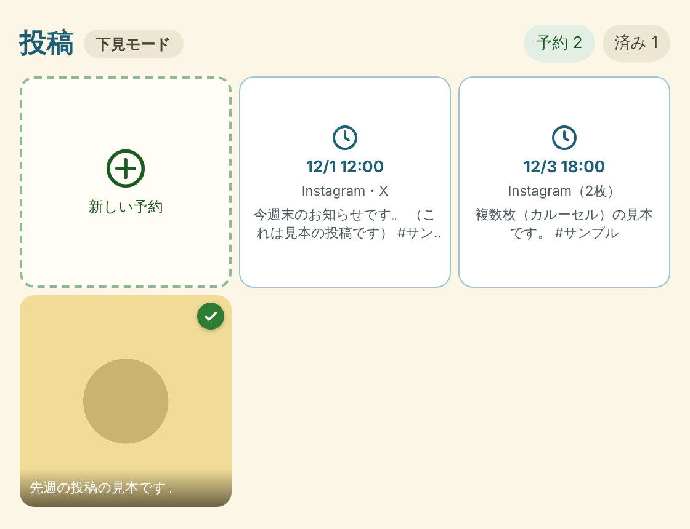
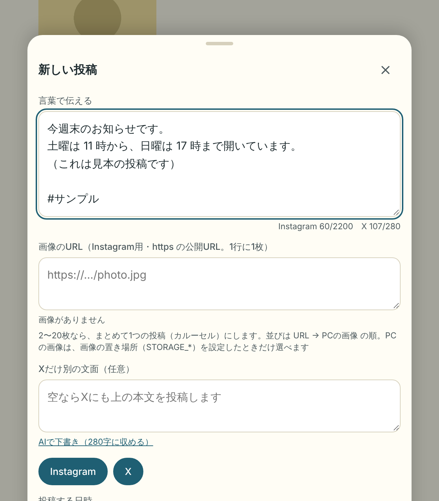

# sns-toukou-automation

[](https://github.com/supernova2005y/sns-toukou-automation/actions/workflows/test.yml)
[](LICENSE)


Instagram と X に、**公式APIだけ**で予約投稿するための小さなツール。
Markdown で書いた投稿ファイルを `posts/queue/` に置くと、時刻が来たものを投稿します。
X 用の短い文面は、**生成AI（Gemini / Claude）で下書き**できます。

| 予約の一覧（`sns-post web`） | 新しい予約（「AIで下書き」つき） |
|---|---|
|  |  |

## このリポジトリで見てほしいところ

| 見どころ | 中身 | ファイル |
|---|---|---|
| 困りごとから作った | 「投稿ボタン」ではなく「続ける手間」と「担当者がいないと止まること」を解く形にした | 下の「なぜ作ったか」 |
| 生成AIをアプリに組み込んだ | Instagram の本文から、X の280文字（日本語は1文字=2）に収まる文面の下書きを作る。Gemini と Claude を `.env` で切り替えられる | `src/sns_post/llm.py`・`src/sns_post/draft.py` |
| 生成AIの苦手をツール側で補った | 文字数は生成AIではなくツールが数え、超えたら何文字だったかを伝えて作り直させる。URL が消えたら知らせる。下書きは投稿しない | `src/sns_post/draft.py`・`docs/セットアップ.md` |
| 公式ドキュメントで確かめる | API の上限・料金・モデル名は公式ドキュメントで確かめ、出典を残す。確かめていないことは「未確認」と書く | `docs/セットアップ.md` の「出典」、下のチェックリスト |
| 壊さない工夫 | 既定は下見（投稿しない）、二重投稿の防止、テスト156件（API は偽物に差し替え）、GitHub Actions で自動テスト | `tests/` |

## なぜ作ったか

小さなお店から「Instagram の運用を手伝ってほしい」と相談されたのがきっかけです。
話を聞くと、困っているのは投稿ボタンを押すことではなく、**毎回の投稿を続ける手間**と、**担当者がいないと止まってしまうこと**でした。

そこで、人に頼らなくても回る形を目指しました。

- 投稿は **Markdown ファイル1つ**。パソコンに詳しくない人でも、テンプレートを書き換えるだけで予約できる
- 一度設定すれば、作った人（自分）がいなくても動き続ける
- お店のアカウントを守るため、**公式APIだけ**を使い、規約違反になりうる自動いいね・フォローはしない

## 設計で大事にしたこと

| 判断 | 理由 |
|---|---|
| 既定は**下見（dry-run）**。`--publish` のときだけ投稿する | 誤投稿を防ぐため |
| 投稿に成功した先を、その都度ファイルに記録する | Instagram は成功・X は失敗、のように途中で止まっても、再実行で二重投稿しないため |
| X の文字数を X と同じ重みつきで数える | 文字数超過による投稿の失敗を防ぐため |
| 投稿内容と設定をファイルで保持する（データベースを使わない） | 中身が人の目で読め、Git で履歴が残り、引き継ぎやすいため |
| API の部分を差し替えられる形にする（`Protocol`） | 本物の API を呼ばずにテストでき、ほかの SNS に拡張しやすいため |
| X の料金の目安を下見に表示 | X API は従量課金なので、実行前に費用が分かるようにするため |
| 生成AIは下書きまでを行う。文字数はツールが数え、投稿は人が決める | 生成AIは日本語の重みつき文字数を正確に数えられず、事実（日時・値段）を書き換えることもあるため |

## 構成

```
posts/queue/*.md ──▶ posts.py（読み込み・書き方チェック）
                         │
                         ▼
                    runner.py（時刻が来たものを選ぶ・下見 or 投稿・結果を記録）
                      │                 │
                      ▼                 ▼
               instagram.py           x.py
          （Graph API・2段階投稿）  （API v2・OAuth 1.0a）

draft.py（X 用の文面の下書き。文字数を数えて作り直させる）──▶ llm.py（Gemini / Claude を差し替え）
                         │
                         ▼
                  posts/done/ に移動
```

## 技術スタック

| カテゴリ | 使っているもの |
|---|---|
| 言語 | Python 3.10+ |
| SNS の API | Instagram Graph API（Unified Login）、X API v2（OAuth 1.0a）。requests・requests-oauthlib で直接呼ぶ |
| 生成AI（任意） | Gemini（google-genai）・Claude（anthropic）の公式 SDK。`.env` の `LLM_PROVIDER` で切り替え |
| 予約画面 | Python の標準ライブラリだけのローカル Web サーバー＋素の HTML・CSS・JavaScript |
| 画像の置き場所（任意） | S3 互換ストレージ（boto3）。非公開のバケット＋期限つきURL |
| データ | Markdown＋YAML の投稿ファイル（PyYAML）。データベースは使わない |
| テスト | pytest（156件。SNS の API も生成AIも偽物に差し替え） |
| CI | GitHub Actions（push のたびに Python 3.10 と 3.13 でテスト） |
| 開発 | Claude Code |

- 開発の進め方: 生成AI（Claude Code）と一緒に、仕様の整理 → 実装 → テストの順で作りました。作業のまとまりごとに小さく commit し、何を・なぜ変えたかをメッセージに書いています

## このリポジトリの範囲

- ツールのコードとその説明だけ（`src/`・`tests/`・`docs/`・`examples/`）
- 特定のお店・人との打ち合わせメモ、やりとり、実際の投稿内容、認証情報は置きません（別の非公開の場所で管理）
- 使い方を試すときは、自分のテスト用アカウントを使ってください

## できること 
 - 予約投稿（Instagram の画像、X のテキスト）
 - 1つのファイルから Instagram と X へ同時投稿
 - X 用の文面の下書き（生成AI。投稿はしない）
 - 下見（dry-run）が既定。`--publish` をつけたときだけ投稿
 - 途中で失敗しても二重投稿しない
 
## やらないこと
 - 自動いいね・自動フォロー・自動DM
 - Cookie の使用
 - 生成AIの文面をそのまま自動で投稿すること
 - 他人のパスワードを預かること

## はじめ方

認証情報がなくても、下見モードで画面とテストまで動かせます。

```bash
git clone https://github.com/supernova2005y/sns-toukou-automation.git
cd sns-toukou-automation
pip install -e ".[dev]"          # 生成AIの下書きも使うときは ".[dev,llm]"
pytest                           # テスト（本物の API は呼ばない）

cp .env.example .env             # 実際に投稿するときだけ、認証情報を入れる（手順は docs/セットアップ.md）
cp "examples/2026-11-01_1200_サンプル.md" posts/queue/   # 見本の投稿ファイルを置く
sns-post check                   # 書き方の確認
sns-post web                     # 予約画面 → http://localhost:8000/ （下見モード。投稿はしない）
```

## 使い方（コマンド一覧）

```bash
sns-post web                     # 予約画面をブラウザで開く（http://localhost:8000/）。投稿はしない
sns-post web --publish           # 予約画面から投稿する（今すぐ投稿・時刻が来たら自動投稿）
sns-post check                   # 書き方の確認
sns-post draft-x <投稿ファイル>   # 生成AIで X 用の文面の下書きを表示（--write で x_text に書き込む）。投稿はしない
sns-post run-due                 # 下見：どれが投稿されるかを表示するだけ
sns-post run-due --publish       # 実際に投稿（時刻が来たものだけ）
sns-post -C <フォルダ> run-due --publish --log posts/run.log   # 定期実行用（手順は docs/セットアップ.md）
sns-post schedule                # 定期実行の登録内容を表示するだけ。--install で登録（Windows）、--remove で消す
sns-post limit                   # Instagram の投稿上限の使用状況
sns-post refresh-token           # 旧 Instagram ログイン方式のトークン更新（有効60日）。Unified Login のトークンは期限がないので不要
pytest                           # テスト
python -m sns_post check         # sns-post.exe が使えないPC（アプリケーション制御）では、sns-post の代わりに python -m sns_post と書く
```

### 予約画面

`sns-post web` を動かしたまま、ブラウザで http://localhost:8000/ を開きます。

- 一覧：左上の「新しい予約」、予約中（時計と日時）、済み（右上に ✓）。時刻を過ぎても投稿されていないものは赤く出ます
- 「新しい予約」から本文・画像URL・投稿先・日時を入れて「予約する」→ `posts/queue/` に投稿ファイルが1つできます
- 「Xだけ別の文面」の下の「AIで下書き」を押すと、本文から X の280文字に収まる文面の下書きが入ります（`.env` に生成AIの API キーがあるときだけ表示。読んで直してから予約します）
- 予約中のタイルを押すと、本文・日時などの変更と取り消しができます。取り消した予約は消さずに `posts/cancelled/` へ移ります（戻すときはファイルを `posts/queue/` に戻すだけ）
- どこか1つにでも投稿済みの予約は、変更・取り消しできません（二重投稿や記録の食い違いを防ぐため）。画面を開いたあとにファイルが書き換わっていたら、上書きせずに読み込み直しを促します
- **`sns-post web` のままでは投稿しません**（画面の上に「下見モード」と出ます）
- `sns-post web --publish` で起動すると「投稿モード」になり、次のことをします。サーバーを止めると止まります
  - 予約の変更画面にある「保存した内容で今すぐ投稿」で、時刻を待たずに投稿する（確認ダイアログあり）
  - 時刻が来た予約を、1分ごとに自動で投稿する
  - 一部の投稿先だけ済んでいる予約は、タイルを押すと残りに投稿する
  - 結果は画面下の「最近の投稿の記録」に出ます
  - 投稿モードは自分のPCで開くときだけ使えます（`--host 0.0.0.0` とは一緒に使えません）
  - `.env` に認証情報がない投稿先があると、起動したときと画面の上に赤く知らせます（その先はスキップされます）。`.env` は起動したときに1回だけ読むので、書いたら起動し直します
  - アプリを開かずに投稿だけ済ませられるので、おすすめやリールを見ずに済みます
- 既定では自分のPCからしか開けません。`--host 0.0.0.0` でスマホからも開けますが、認証がないので家のWi-Fiなど信頼できる場所だけで

投稿ファイルの形：

```markdown
---
publish_at: 2026-11-01T12:00:00+09:00   # タイムゾーンつきで書く
targets: [instagram, x]
image_url: https://example.com/photo.jpg  # Instagram には必須（JPEG・公開URL）
x_text: Xだけ文面を変えたいとき（任意）
---
本文。Instagram のキャプションになる。
```

複数枚（カルーセル）にするときは、`image_url` の代わりに `images:` に2〜20枚を並べます（見本は `examples/2026-11-01_1800_複数枚サンプル.md`）。URL と、画像の置き場所に上げた `image_key` を混ぜて書けます。予約画面では、URL を1行に1枚書くか、PCの画像をいくつか選ぶと複数枚になります。

```markdown
images:
- https://example.com/1.jpg
- images/xxxx.jpg
```

- 投稿に成功した先は、ファイルの `results:` に記録されます。全部の先に投稿できたら `posts/done/` に移ります
- Instagram は24時間で100投稿まで（カルーセルは1投稿）。確認は `sns-post limit`
- X は従量課金。通常の投稿 約0.015ドル、リンク付き 約0.20ドル。下見で目安が出ます

## 作ってあるもの / まだないもの

- [x] 投稿ファイルの読み込みと書き方チェック
- [x] Instagram（画像1枚・複数枚のカルーセル）と X（テキスト）の投稿
- [x] 下見モード、二重投稿の防止、テスト（156件）
- [x] X の文字数を X と同じ数え方で確認（日本語は1文字=2、URLは23）
- [x] 実際のアカウントでの動作確認：Instagram（Unified Login、画像1枚）は投稿・done/ への移動まで確認
- [ ] 実際のアカウントでの動作確認：X
- [x] Instagram の Unified Login（`graph.facebook.com`）での接続と投稿
- [x] 画像の置き場所：S3互換ストレージ＋期限つきURL（`image_key`）。偽のクライアントでのみ確認、実際のバケットと Meta が署名付きURLを取れるかは**未確認**（手順は docs/セットアップ.md）
- [x] 定期実行：`-C`（作業フォルダ）と `--log`（結果の記録）、`sns-post schedule --install` でタスクスケジューラに登録（Mac・Linux は cron の1行を表示）。手順は `docs/セットアップ.md`（Windows での登録と、下見モードでの定期実行は確認済み。`--publish` での実際の投稿は**未確認**。Mac・Linux も**未確認**。GitHub Actions は二重投稿のおそれがあるので使わない）
- [x] Instagram の複数枚投稿（カルーセル、2〜20枚。`images:`。予約画面からも作れる）。偽のAPIでのみ確認、実際のアカウントでは**未確認**
- [ ] Instagram の動画・リール・ストーリーズ
- [x] X 用の文面の下書き（生成AI。`sns-post draft-x`・予約画面の「AIで下書き」。Gemini / Claude）。偽のモデルでのみ確認、実際の API キーでは**未確認**
- [x] 予約画面（`sns-post web`）。一覧と、予約ファイルの書き出し
- [x] 予約画面で予約の変更・取り消し（取り消しは `posts/cancelled/` へ移動）、Xだけ別の文面
- [x] 予約画面から投稿（`sns-post web --publish`。今すぐ投稿・自動投稿。偽のAPIでのみ確認、実際のアカウントでは**未確認**）
- [x] 予約画面で画像をPCから選ぶ（STORAGE_* を設定したときだけ表示。偽の置き場所とブラウザでのみ確認、実際のバケットは**未確認**）

## 注意

- `.env` は GitHub に上げない（`.gitignore` 済み）。トークンをチャットやログに貼らない
- APIのバージョン・上限・料金は変わるので、使う前に公式ドキュメントで確認する（`docs/セットアップ.md` に出典）
- 最初は、自分のテスト用アカウントだけで試す

## ライセンス

MIT License（`LICENSE` を参照）。無保証です。SNS への投稿は自分の責任で、まずテスト用アカウントで試してください。
